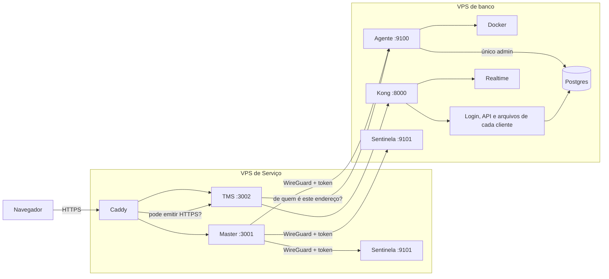
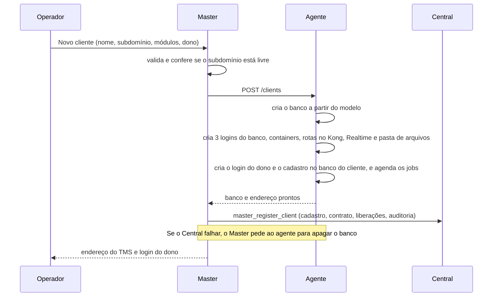

# FrotaK · Arquitetura atual e o que mudou

Guia para quem vai mexer no front ou no back do FrotaK. Explica como o sistema está **hoje**, como era **antes** e por que mudou, e como fazer uma alteração sem quebrar nada.

- **Situação em:** 2026-11-06, `main` @ `f1a42d3`.
- **Mudanças cobertas:** os 53 commits de `0cc1f2a` a `f1a42d3`, feitos entre 2026-11-02 e 2026-11-06.
- **Ponto de partida:** `92a7213`.

Para aprofundar:

| Assunto | Documento |
|---|---|
| Módulos, camadas e liberação por cliente | [docs/frotak-master/arquitetura-modular.md](docs/frotak-master/arquitetura-modular.md) |
| Operação das VPS: instalar, publicar, backup, painel, auto-heal | [deploy/README.md](deploy/README.md) |
| Evidências, testes, achados e próximos passos | [docs/frotak-master/CHECKPOINT.md](docs/frotak-master/CHECKPOINT.md) |

> **Atenção:** o [README.md](README.md) é o briefing original do protótipo, e o [CLIENT_SYSTEM_INTEGRATION.md](CLIENT_SYSTEM_INTEGRATION.md) descreve o login por `sso_token` na URL, que não é mais usado. Os dois ficam como histórico.

---

## 1. Em um minuto

O repositório tem **dois sistemas**:

| Sistema | Pasta | Para quem | O que faz |
|---|---|---|---|
| **Master** (também chamado de Central) | raiz do repositório | Equipe FrotaK | Cadastra clientes e escolhe os produtos e módulos de cada um. Cria e administra o ambiente de cada cliente e acompanha a infraestrutura |
| **TMS** (sistema do cliente) | `central-dias-main/` | Transportadoras clientes | Gestão de frota, financeiro, Frotak IA, rastreadores, app do motorista |

**Pilha:** React 19, TanStack Start, Vite e Supabase (Postgres, Auth, PostgREST, Realtime e Storage).

O TanStack Start junta **front e back no mesmo app**. O código de servidor (as *server functions*) mora ao lado das telas e roda num servidor Node, então não existe um projeto de backend separado.

O sistema roda em **dois modos**, escolhidos por variável de ambiente:

| Modo | Onde roda | Como os dados ficam |
|---|---|---|
| **Banco único** | Produção atual: Lovable, Vercel e Supabase hospedado | Todos os clientes no mesmo banco, separados por `tenant_id` e RLS |
| **Banco por cliente** | As duas VPS novas | Cada cliente tem banco, login, API, chaves e arquivos próprios, criados e controlados pelo Master |

Todo código novo precisa funcionar **nos dois modos**.

---

## 2. Antes e depois

| Tema | Antes (`92a7213`) | Hoje |
|---|---|---|
| **Telas do Master** | Protótipo visual: a maioria com dados fictícios (`src/lib/mock.ts`) e números inventados | Dashboard, Clientes, Ficha do cliente e Painel de controle com dados reais. As telas fictícias que restam ficam escondidas com `VITE_FROTAK_HIDE_PROTOTYPES=true` |
| **Código do Master** | Arquivos soltos em `src/lib` (`tenantProvisioning.ts`, `masterControl.ts`, `supabaseAdmin.ts`) | Clean architecture em `src/core` e `src/modules/<módulo>`, com `domain`, `application`, `infrastructure`, `server.ts` e `ui` |
| **Login da equipe** | E-mail e senha | E-mail, senha e **2FA obrigatório** (TOTP), cobrado em três lugares: tela, servidor e banco |
| **Autorização no servidor** | O navegador mandava o token do operador para a função de cadastro | Toda server function passa pelo middleware `platformAuth`, que valida a sessão (com 2FA) e o papel do usuário |
| **"Login como cliente"** | O token ia na URL para o sistema do cliente (`sso_token`) | Credencial de uso único do dono do cliente, registrada em `audit_logs`. O TMS mostra o aviso "Modo suporte" |
| **Módulos por cliente** | Existiam no cadastro, mas o TMS não obedecia: menu fixo e nenhuma rota bloqueada | Produtos (TMS, View) e módulos ligados e desligados por cliente, valendo em segundos. Bloqueio no banco (RLS e RPC), no servidor e na tela |
| **Organização do TMS** | Por tipo de arquivo: `src/components`, cerca de 35 arquivos soltos em `src/lib`, `server/api/sascar` | Por módulo, em `src/modules/<módulo>` com camadas. Menu e bloqueio vêm do registro `src/modules/registry.ts`. O lint barra import fora da regra |
| **Integrações** (Sascar, Gemini, push) | Chamadas diretas espalhadas pelo código | Atrás de **portas** (interfaces): trocar ou somar um fornecedor é escrever um adaptador novo |
| **Banco** | Um Supabase hospedado para todos, com `tenant_id` e RLS | Mantido na produção. Nas VPS, **um banco por cliente**, criado a partir de um modelo, mais o banco do Central |
| **Endereço do cliente** | Um único endereço do TMS; o cliente era descoberto pelo usuário logado | Cada cliente tem o próprio endereço (`<subdomínio>.<domínio base>`), que pode mudar. Aceita até 5 domínios do próprio cliente, com HTTPS automático |
| **Infraestrutura** | Só Lovable, Vercel e Supabase hospedado | Mais duas VPS (Serviço e Banco) ligadas por WireGuard, com scripts de instalação em `deploy/` |
| **Backup** | O do Supabase hospedado | Diário, com cópia física e um arquivo por cliente; cópia na outra VPS; teste de restauração semanal; restauração de **um cliente só** |
| **Monitoramento** | Nenhum | Painel de controle no Master com servidores, containers, bancos e tabelas, saúde por cliente, logs e backups |
| **Auto-heal** | Nenhum | Uma sentinela em cada VPS reinicia sozinha o que caiu, com limite de tentativas, e avisa no painel |
| **Testes** | Poucos | Testes de módulo com portas falsas (TMS e Master), testes da sentinela e do agente, testes SQL, e roteiros de navegador nos endereços reais |

---

## 3. Linha do tempo das mudanças

Cada fase traz os commits principais. O histórico completo está em `git log 92a7213..f1a42d3`.

**1. Master modular e liberação por cliente** (2026-11-02, `0cc1f2a`)
- Migration `202610310001`: cria os produtos (`tms` e `view`), os produtos de cada cliente e o módulo `driver_app`.
- A mesma migration traz o bloqueio por módulo no financeiro e no app do motorista, a função `get_workspace_entitlements` e os comandos auditados do Master.
- Master reorganizado em `src/core` e `src/modules/{catalog,entitlements,tenants,provisioning}`.

**2. TMS separado em módulos** (2026-11-02, de `1f98144` a `df82eec`)
- Registro de módulos e um commit por módulo: Frotak IA, Rastreadores, App Motorista, Financeiro e Gestão de Frota.
- As rotas ficaram finas: a tela vem do módulo.

**3. Clean architecture no TMS** (2026-11-02 a 04, de `848b3ab` a `d04bede`)
- Casos de uso e portas em `application/`, adaptadores em `infrastructure/` e composição em `api/` e `container.ts`.
- `eslint.architecture.js` barra dependência na direção errada.
- `npm run test:modules` testa os casos de uso sem banco e sem rede.

**4. Implantação nas VPS** (2026-11-04, `a7ad7a3`)
- Supabase próprio em Docker, Master e TMS atrás do Caddy, WireGuard, firewall e backup.

**5. Segurança** (2026-11-05, de `e680637` a `7a44c93`)
- 2FA da equipe (migration `202611050001`) e "Login como cliente" auditado.
- Frota bloqueada por módulo e telas fictícias escondidas.
- Retenção de posições em 24 h e agendamento da Sascar (migration `202611050002`).
- A sequência de migrations passou a montar um banco do zero.

**6. Um banco por cliente** (2026-11-05, de `e92f1d9` a `6c13a71`)
- Agente provisionador na VPS de banco.
- O Master cria e controla cada cliente no banco dele, e o cadastro no Central fica em `client_databases` (migration `202611050003`).
- O TMS escolhe o banco pelo endereço.
- Restauração por cliente.

**7. Painel de controle e auto-heal** (2026-11-05, de `4606163` a `ac59822`)
- Sentinela em cada VPS e Painel de controle no Master.

**8. Ficha do cliente** (2026-11-05, de `507c323` a `4ca47f3`)
- Endereço separado do identificador, domínios próprios, edição do cadastro, suspensão, nova senha e inventário do que foi criado (migration `202611050004`).
- Aviso de empresa suspensa no TMS (migration `202611050005`).
- **Correção de segurança:** os logins do banco de cada cliente conseguiam entrar no banco do Central. Corrigido.

**9. Envio para a `main`** (2026-11-06, `2c05c9c` e `f1a42d3`)
- A branch `feat/master-modulos-por-cliente` entrou por avanço direto, sem reescrever histórico.

---

## 4. Como o sistema está hoje

### 4.1 Onde fica cada coisa

```
frotak-master/
├─ src/                          MASTER (front + back)
│  ├─ core/
│  │  ├─ domain/                 erros de domínio, ator da equipe e papéis
│  │  ├─ auth/platform-auth.ts   middleware de toda server function (sessão + 2FA + papel)
│  │  └─ server/                 Supabase com chave de serviço, cliente do agente, runUseCase
│  ├─ modules/
│  │  ├─ catalog/                produtos e módulos (códigos são contrato com banco e TMS)
│  │  ├─ entitlements/           ligar e desligar produto e módulo por cliente
│  │  ├─ provisioning/           criar cliente (banco único ou banco por cliente)
│  │  ├─ tenants/                lista, ficha e administração do cliente (admin-server.ts)
│  │  └─ control-panel/          painel de controle da infraestrutura
│  ├─ components/kit, ui         componentes visuais do Master
│  └─ routes/                    telas finas: clientes.tsx, clientes_.$slug.tsx, infraestrutura.tsx...
│
├─ central-dias-main/            TMS (front + back)
│  ├─ src/server.ts              entrada do servidor: escolhe o cliente pelo endereço
│  ├─ src/modules/<módulo>/      fleet-core, financial, frotak-ai, frotak-tracking, driver-app, cte-issuance
│  │  ├─ module.ts               manifesto: código, rotas e itens de menu
│  │  ├─ domain/ application/ infrastructure/ api/ ui/ container.ts
│  ├─ src/modules/registry.ts    lista de módulos: monta o menu e decide o dono de cada rota
│  ├─ src/routes/api/            rotas HTTP chamadas de fora (push, Sascar)
│  ├─ server/lib/                conexão com o banco do cliente, chave de serviço
│  └─ src/components/frotak, ui  componentes visuais do TMS (reutilize-os)
│
├─ supabase/
│  ├─ migrations/                77 migrations: tabelas, RLS, RPCs e regras de negócio no banco
│  └─ tests/                     testes SQL
│
└─ deploy/                       instalação e operação das VPS
   ├─ common/                    base, WireGuard, firewall e a sentinela (sentinel/)
   ├─ db/                        VPS de banco: compose, agente (agent/), backup, migrações
   └─ service/                   VPS de Serviço: Caddy, systemd, publicação dos apps
```

### 4.2 Master: camadas e regras

Cada módulo de `src/modules` segue a mesma divisão:

| Camada | O que tem | Pode importar |
|---|---|---|
| `domain/` | Tipos e regras puras, sem rede nem banco | `core/domain` e domínio de outros módulos |
| `application/` | Casos de uso e portas (interfaces) | `domain/` e as próprias portas |
| `infrastructure/` | Adaptadores: Supabase, agente, sentinelas, DNS | `application/` e `core/server` |
| `server.ts` | Server functions: autenticam, validam e montam o caso de uso | Tudo acima |
| `ui/` | Componentes React do módulo | `domain/` e `server.ts` |

Regras que o código garante:

- **Autenticação em toda server function:** todas usam `.middleware([platformAuth])`, que resolve o ator (usuário da equipe com 2FA) e o põe em `context.actor`.
- **Papéis:** `super_admin`, `operations`, `support` e `read_only`.
  - Ler: todos.
  - Alterar: `super_admin` e `operations` (`assertCanOperate`).
  - Ver dados de tabela de cliente e reiniciar o Postgres: só `super_admin` (`assertSuperAdmin`).
- **Erros:** passam por `runUseCase`. Um erro de negócio chega à tela com a mensagem; uma falha de infraestrutura vai para o log, e o operador vê uma mensagem genérica.
- **Pasta proibida:** uma pasta chamada `server/` não pode ser importada pelo navegador (regra do TanStack Start). Por isso o middleware fica em `core/auth`.

### 4.3 TMS: módulos e camadas

Cada módulo tem um manifesto (`module.ts`) com o código do módulo, as rotas que são dele e os itens de menu. O `AppLayout` pede ao registro os itens dos módulos liberados e usa `moduleForPath` para bloquear a rota de um módulo desligado.

| Pasta do módulo | O que tem | Pode importar |
|---|---|---|
| `domain/` | Regras puras | Só `domain/` |
| `application/` | Casos de uso e `ports.ts` | `domain/` e as portas |
| `infrastructure/` | Adaptadores: Supabase, Sascar SOAP, Gemini, Web Push | `application/` e `domain/` |
| `api/` | Server functions e handlers HTTP | Todas as camadas do módulo |
| `container.ts` | Composição no navegador | Todas as camadas do módulo |
| `ui/` | Telas e componentes | `domain/`, `container.ts` e `api/`, **nunca** `infrastructure/` |

O lint (`central-dias-main/eslint.architecture.js`) barra o que fugir dessa tabela.

`src/server.ts` é a porta de entrada de toda requisição. No modo banco por cliente, ele:
1. lê o endereço da requisição;
2. pergunta ao agente de quem é esse endereço (`GET /resolve?host=`);
3. guarda a conexão daquele cliente só durante a requisição (`AsyncLocalStorage`);
4. entrega ao navegador só a chave pública do cliente (`/frotak-client.js`);
5. responde ao Caddy se um endereço pode receber HTTPS (`/__frotak/tls-ask`).

### 4.4 Banco de dados

**Tabelas e funções principais** (as mesmas migrations valem para todos os bancos):

| O quê | Tabelas e funções |
|---|---|
| Cliente e empresa | `tenants` (cliente, com `status`), `workspaces` (empresa), `workspace_memberships` (quem é membro) |
| Catálogo e liberações | `platform_products`, `tenant_platform_products`, `modules`, `workspace_modules` |
| Equipe e auditoria | `platform_users` (equipe FrotaK e papel), `audit_logs` |
| Endereço do cliente (Central) | `client_databases`: identificador, nome do banco, subdomínio, domínios próprios, endereço |
| Decisão de bloqueio | `private.workspace_has_module` (só libera clientes `active` ou `trial`), `private.can_access_tenant` e `private.fleet_enabled_tenants` (frota) |
| Leitura do app | `get_workspace_entitlements` (o que o TMS e os servidores consultam) |
| Comandos do Master | `master_set_tenant_module`, `master_set_tenant_product`, `master_register_client`, `master_update_client_profile`, `master_set_client_status`, `master_set_client_addresses`. Todos validam o ator (`private.require_master_operator`) e gravam em `audit_logs` |
| Equipe com 2FA | `private.is_platform_user` exige sessão `aal2` |

**Como o bloqueio funciona:** desligar um módulo não apaga dados, só fecha o acesso.
- O banco recusa com `MODULE_DISABLED:<módulo>`.
- As policies de RLS deixam de devolver as linhas.
- A tela esconde o menu e mostra uma explicação.

Quem garante o bloqueio é o banco; a tela só dá conforto.

**Bancos nas VPS:**

| Banco | Para quê |
|---|---|
| `frotak_central` | Cadastro do Master: clientes, contratos, liberações, equipe e auditoria |
| `frotak_<cliente>` | Tudo de um cliente: operação, financeiro, logins e auditoria |
| `frotak_template` | Modelo com todas as migrations; cada cliente nasce de uma cópia dele |
| `frotak_jobs` | Só os agendamentos (`pg_cron` e `pg_net` atendem um banco por servidor) |

### 4.5 Variáveis de ambiente

| Variável | App | Para quê |
|---|---|---|
| `VITE_SUPABASE_URL`, `VITE_SUPABASE_ANON_KEY` | Master e TMS | API e chave pública (no banco por cliente, a chave do TMS vem de `/frotak-client.js`) |
| `SUPABASE_URL`, `SUPABASE_SERVICE_ROLE_KEY` | Master e TMS (servidor) | Acesso de serviço ao banco |
| `VITE_FROTAK_CLIENT_APP_URL` | Master | Banco único: endereço do TMS para o "Login como cliente" |
| `VITE_FROTAK_HIDE_PROTOTYPES` | Master | `true` esconde as telas fictícias |
| `VITE_FROTAK_CONTROL_PANEL` | Master | `true` mostra o Painel de controle (só onde há sentinelas) |
| `FROTAK_AGENT_URL`, `FROTAK_AGENT_TOKEN` | Master e TMS (servidor) | **Ligam o modo banco por cliente.** Sem elas, banco único |
| `VITE_FROTAK_MULTI_DB` | TMS | `true` no build do banco por cliente: login próprio e chaves do cliente |
| `FROTAK_SENTINEL_DB_URL`, `FROTAK_SENTINEL_SERVICE_URL`, `FROTAK_SENTINEL_TOKEN` | Master (servidor) | Fala com as sentinelas das VPS |
| `VITE_FROTAK_MASTER_LOGIN_URL` | TMS | Para onde mandar quem não tem sessão, no banco único |
| `GEMINI_API_KEY`, `GOOGLE_MAPS_API_KEY`, `SASCAR_USER`, `SASCAR_PASSWORD` | TMS (servidor) | Frotak IA, endereços e rastreador. Sem elas, a função avisa que não está configurada |
| `FROTAK_PUSH_CRON_TOKEN`, `SASCAR_SYNC_TOKEN` | TMS (servidor) | Protegem as rotas chamadas pelos agendamentos |
| `VAPID_PUBLIC_KEY`, `VAPID_PRIVATE_KEY`, `VAPID_SUBJECT` | TMS (servidor) | Notificações push |

Nas VPS, todos os valores ficam em `/etc/frotak/*.env`, fora do Git.

---

## 5. Como o Master controla os ambientes remotos

### 5.1 As peças



- **Agente** (`deploy/db/agent/frotak_agent.py`): o único com acesso de administrador ao Postgres e ao Docker da VPS de banco.
  - Escrito em Python, só com a biblioteca padrão.
  - Escuta só no IP da WireGuard e exige token.
  - O Master nunca toca no Postgres diretamente; ele pede ao agente.
- **Sentinela** (`deploy/common/sentinel/frotak_sentinel.py`): uma em cada VPS.
  - Mede a máquina, os serviços e os containers e guarda o histórico.
  - Conserta sozinha o que sabe consertar (auto-heal).
  - Responde ao Painel de controle.
- **Kong:** o portão da API. Cada cliente tem rotas em `/c/<cliente>/...` e chaves próprias.
- **Caddy:** HTTPS automático. O certificado de um cliente sai na primeira visita, e só se o TMS confirmar que o endereço existe.
- **Rede:**
  - VPS de banco: só a porta 22 aberta para a internet.
  - VPS de Serviço: só as portas 22, 80 e 443.
  - Entre as duas: WireGuard.

### 5.2 Criar um cliente (banco por cliente)



O banco nasce **antes** do cadastro no Central. Os gatilhos do cadastro criam dados no banco onde rodam, e essa ordem evita deixar um "cliente fantasma" no Central.

### 5.3 Uma requisição no TMS do cliente

1. O usuário abre `https://acme.<domínio base>`.
2. Na primeira visita, o Caddy pergunta ao TMS se pode emitir HTTPS para esse endereço; o TMS consulta o agente.
3. O `src/server.ts` do TMS pergunta ao agente de quem é o endereço e recebe a conexão do cliente (guardada em cache por 30 s).
4. O navegador recebe só a URL da API e a chave pública **daquele** cliente, e fala com `/c/acme/...` no Kong.
5. O banco do cliente aplica RLS e o bloqueio por módulo, como no banco único.

### 5.4 Cada ação do Master e o que acontece por baixo

| Ação no Master | Onde | O que acontece |
|---|---|---|
| Criar cliente | Clientes > Novo cliente | Seção 5.2. No banco único: cria o login do dono e chama `provision_tenant` |
| Ligar ou desligar módulo ou produto | Clientes > Gerenciar, ou ficha > Produtos e módulos | Agente `POST /clients/<id>/entitlements` aplica no banco do cliente, depois o Central é atualizado. Vale em segundos, sem deploy |
| Login como cliente | Clientes ou ficha | Agente `POST /clients/<id>/support-login` gera uma credencial de uso único do dono. O acesso fica em `audit_logs` antes de a credencial sair do servidor |
| Editar cadastro (nomes, CNPJ, limite de veículos) | Ficha > Cadastro | Agente `POST /clients/<id>/profile` aplica no banco do cliente, depois `master_update_client_profile` no Central. O TMS mostra o nome novo em até 30 s |
| Suspender ou reativar | Ficha > Cadastro | Agente `POST /clients/<id>/status`, depois `master_set_client_status`. Suspenso, o TMS mostra "Acesso da empresa suspenso", e os dados ficam |
| Mudar o subdomínio | Ficha > Endereço e domínios | Agente `POST /clients/<id>/subdomain` atualiza o roteamento e recria o serviço de login. O endereço antigo para de abrir em até 30 s. Banco, dados e logins não mudam |
| Ligar ou desligar domínio do cliente | Ficha > Endereço e domínios | Agente `POST` ou `DELETE /clients/<id>/domains`. A ficha mostra os registros de DNS (CNAME ou A) e confere DNS, HTTPS e TMS |
| Gerar senha temporária | Ficha > Logins | Auditoria primeiro, depois o agente `POST /clients/<id>/login-password`. A senha aparece uma vez |
| Ver o que foi criado | Ficha > Resumo e Ambiente criado | Agente `GET /clients/<id>/resources`: banco, logins do banco e onde cada um entra, containers, rotas, tempo real, arquivos, jobs, backup e chaves (só a existência, nunca o valor) |
| Ver servidores, containers e logs | Infraestrutura > Painel de controle | Sentinelas `GET /overview`, `/metrics` e `/logs`. Os logs saem sem senha nem token |
| Reiniciar container ou serviço | Painel > Servidores ou Containers | Auditoria primeiro, depois a sentinela `POST /restart`. O Postgres só com `super_admin` e confirmação digitada |
| Pausar ou ligar o auto-heal | Painel > Auto-heal | Auditoria, depois a sentinela `POST /heal` |
| Ver bancos, tabelas e dados | Painel > Bancos de dados | Agente `/panel/*`, só leitura. Ver linhas exige `super_admin`, fica na auditoria e mascara colunas sensíveis |

Ainda não têm botão: apagar cliente (existe `DELETE /clients/<id>` no agente) e restaurar backup (feito pelo terminal, de propósito).

### 5.5 Auto-heal (sentinela)

- **Rotina:** confere tudo a cada 30 s.
- **Quando age:** só depois de cerca de 90 s de falha seguida. Um soluço de rede não dispara conserto.
- **Limite:** 3 tentativas em 30 minutos. Depois disso, para e abre o alerta "precisa de uma pessoa".
- **Postgres:** nunca é reiniciado sozinho, porque derrubaria todos os clientes. Só avisa.
- **Cliente em manutenção:** o agente marca o cliente enquanto cria, apaga ou restaura, e a sentinela não mexe nele.
- **Disco:** a partir de 90%, limpa log antigo do sistema e imagem Docker sem uso. Nunca toca em dados nem em backups.
- **Testado com falhas reais:** containers, serviços, WireGuard e Master travado voltaram sozinhos em 1 a 3 minutos.

### 5.6 Segurança, em resumo

- **Equipe:** 2FA obrigatório, papéis e auditoria do que muda e de quem viu dados de cliente.
- **Isolamento entre clientes:** banco, JWT, chaves e logins próprios por cliente.
  - Os 3 logins do banco de um cliente entram **só** no banco dele.
  - Token de um cliente não abre outro cliente nem o Central.
- **Senhas e chaves:** ficam só em `/etc/frotak` nas VPS. Nunca aparecem em tela, log, repositório ou documento.
- **Rede:** Postgres, agente e sentinelas não são expostos à internet.

---

## 6. Guia prático para quem vai alterar

### 6.1 Rodar localmente

```bash
npm install && npm --prefix central-dias-main install
npm run dev            # Master
npm run dev:client     # TMS
```

Localmente o sistema roda em **banco único**: basta não definir `FROTAK_AGENT_URL`. Aponte `VITE_SUPABASE_URL`, `VITE_SUPABASE_ANON_KEY`, `SUPABASE_URL` e `SUPABASE_SERVICE_ROLE_KEY` para um Supabase de teste. Para o fluxo de login entre os dois apps, use também `VITE_FROTAK_CLIENT_APP_URL` no Master e `VITE_FROTAK_MASTER_LOGIN_URL` no TMS.

### 6.2 Mudança de front

| Onde | Como |
|---|---|
| Tela do Master | Componente em `src/modules/<módulo>/ui/`; a rota em `src/routes/` só importa. Reutilize `src/components/kit/ui-kit.tsx` e `src/components/ui/` |
| Tela do TMS | Em `central-dias-main/src/modules/<módulo>/ui/`. Reutilize `src/components/frotak` e `src/components/ui`. A tela não importa `infrastructure/`; ela usa `container.ts` ou `api/` |
| Item de menu do TMS | No `module.ts` do módulo, nunca fixo no `AppLayout` |
| Celular | Telas novas não podem ter rolagem lateral em 390 px. Em grade, use `min-w-0` nos filhos, e textos longos precisam poder quebrar |

### 6.3 Mudança de back

**Master: nova server function**

```ts
export const minhaAcaoFn = createServerFn({ method: "POST" })
  .middleware([platformAuth])                       // sempre
  .validator((input: { slug: string }) => validar(input))
  .handler(async ({ data, context }) =>
    runUseCase("modulo.minhaAcao", () => meuCasoDeUso(context.actor, deps(), data)),
  );
```

O caso de uso fica em `application/`. Ele chama `assertCanOperate(actor)` quando altera algo e recebe as portas por parâmetro, para ser testável sem rede. Para servir aos dois modos, monte a dependência pelo modo: `isClientDatabaseMode()` escolhe entre o adaptador do agente e o do Supabase.

**TMS:** a server function fica em `src/modules/<módulo>/api/`. Se depender de módulo liberado, chame `assertWorkspaceModule` no servidor ou `private.workspace_has_module` no banco; só esconder no menu não basta. As rotas HTTP chamadas de fora ficam em `src/routes/api/`.

**Agente ou sentinela:** são Python, só com a biblioteca padrão.
- Toda rota nova do agente passa pelo token. Se ela só ler, ponha em `/panel/*`, que recusa qualquer escrita.
- Testes: `python3 -m unittest deploy/db/agent/test_agent.py` e `deploy/common/sentinel/test_sentinel.py`.

### 6.4 Migration nova

1. Crie um arquivo novo em `supabase/migrations/` (`AAAAMMDDNNNN_descricao.sql`), com `begin` e `commit`. **Nunca edite uma migration já aplicada**; corrija com uma nova.
2. Ela precisa funcionar no Central, no modelo e em cada banco de cliente.
   - O que usar `pg_cron` ou `pg_net` precisa de guarda com `current_database()`, como em `202610150001`, porque nas VPS só `frotak_jobs` tem essas extensões.
3. Escreva ou ajuste um teste em `supabase/tests/`.
4. **Nas VPS:** `python3 /opt/frotak/deploy/db/agent/frotak_agent.py migrate` aplica no modelo, no Central e em todos os clientes. A segunda rodada aplica 0.
5. **Na produção atual:** a migration vai **antes** do deploy do código que depende dela.

### 6.5 Testes

| Comando | O que testa |
|---|---|
| `npx tsc --noEmit` (na raiz e em `central-dias-main`) | Tipos dos dois apps |
| `npm run test:client-admin` | Ficha do cliente: regras e casos de uso com portas falsas |
| `npm run test:control-panel` | Regras de saúde do painel |
| `cd central-dias-main && npm run test:modules` | Casos de uso dos módulos do TMS, inclusive o endereço → cliente |
| `cd central-dias-main && npm run test:frotak-ai` e `npm run test:visual` | Frotak IA e regras visuais |
| `python3 -m unittest deploy/...` | Agente e sentinela |
| Arquivos em `supabase/tests/*.sql` | Regras no banco (rodar num Supabase de teste, nunca no local `frota-master`) |

### 6.6 Publicar

- **VPS:**
  - Apps: `deploy/service/deploy-app.sh` na VPS de Serviço. Ele constrói o Master e o TMS, troca a versão e confere se respondem; as 3 últimas versões ficam guardadas para voltar atrás.
  - Mudou algo em `deploy/`? Copie a pasta e rode de novo `db/install.sh` e `service/install.sh`.
  - Detalhes em [deploy/README.md](deploy/README.md).
- **Produção atual:** a `main` sincroniza com o Lovable.
  - Migrations primeiro; publique o Master logo depois da `202611050001`, porque ela passa a exigir 2FA da equipe no banco.
  - Confira no Supabase se o TOTP está ligado em Auth > MFA.

### 6.7 Armadilhas conhecidas

- **Barra invertida no Git Bash:** editar código por `node -e '...'` no Git Bash do Windows **apaga as barras invertidas**. Em 2026-11-05, isso transformou `/\.$/` em `/.$/` e deixou o TMS fora do ar por cerca de 35 minutos. Edite pelo editor ou com um script salvo em arquivo, e teste o comportamento de toda expressão regular.
- **`routeTree.gen.ts`:** é gerado pelo build e pelo `vite dev`. Não edite à mão.
- **Push na `main`:** sincroniza com o Lovable. Mantenha a `main` funcionando e não reescreva histórico enviado.
- **Equipe sem autenticador:** o Master pede o cadastro do 2FA no primeiro login. Para redefinir, rode `deploy/db/reset-mfa.sh <e-mail>` na VPS de banco.
- **Mudança que só funciona com o agente:** quebra a produção atual. Teste também no banco único (sem `FROTAK_AGENT_URL`).
- **Teste em cliente real:** clientes de teste nas VPS usam identificador começado por `e2e-` e são apagados no fim. O cliente "teste" é do dono do projeto e não deve ser usado em teste.

---

## 7. O que ainda não existe

| Item | Situação hoje |
|---|---|
| Botão de apagar cliente | Só pela API do agente; o cadastro no Central sai à parte |
| Alerta por e-mail ou WhatsApp | O alerta só aparece no painel |
| Troca de senha pelo próprio usuário | O Master gera senha temporária, mas `must_change_password` não é cobrado |
| Cofre de segredos e mTLS com o agente | Segredos em `/etc/frotak`; WireGuard mais token |
| Fila de provisionamento com passos visíveis e atualização em ondas | A criação é síncrona, com desfazer; as migrations vão para todos de uma vez |
| Convite do dono por e-mail | Não há SMTP; o Master define uma senha temporária |
| Armazenamento de objetos e réplica do banco | Arquivos no disco da VPS; sem réplica |
| Teste de carga | A capacidade (cerca de 20 clientes por VPS de banco) é estimativa de memória |
| Produto View | Gravado no catálogo; nenhum sistema deste repositório o consome |

Decisões e evidências de cada item estão em [docs/frotak-master/CHECKPOINT.md](docs/frotak-master/CHECKPOINT.md).
