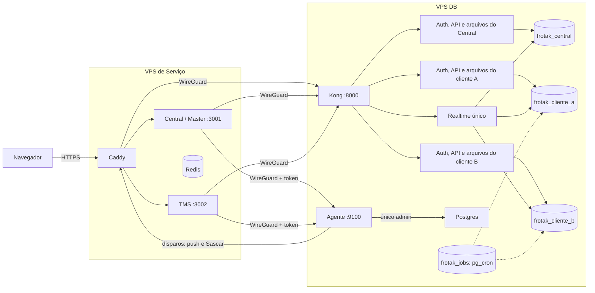

# Implantação nas VPS

Guia para quem opera o FrotaK. Instala o Central (Master) e o TMS em duas VPS Ubuntu, com **um banco para cada cliente**, criado remotamente pelo Master. A VPS View fica fora desta instalação. Nenhum segredo nem IP real fica neste diretório.

## O que roda onde



| Endereço | O que abre |
|---|---|
| `MASTER_HOST` | Central, para a equipe FrotaK, com 2FA |
| `<cliente>.CLIENT_BASE_DOMAIN` | TMS daquele cliente, com login próprio |
| `API_HOST/c/<cliente>` | API daquele cliente, usada pelo navegador |
| `API_HOST` | API do Central |

| Banco | Para quê |
|---|---|
| `frotak_central` | Cadastro de clientes, contratos, liberações, equipe e auditoria do Master |
| `frotak_<cliente>` | Tudo do cliente: operação, financeiro, logins e auditoria. Nasce em segundos, copiado do modelo |
| `frotak_template` | Modelo com todas as migrations. Não aceita conexão |
| `frotak_jobs` | Só os agendamentos. `pg_cron` e `pg_net` atendem um único banco por servidor |
| `postgres` | Origem do modelo. Intocado depois da instalação |

### O que separa um cliente do outro

- **Banco próprio**, com papéis e senhas que não conectam em nenhum outro banco.
- **Chave de assinatura própria.** Token e chaves de um cliente não valem na API de outro nem no Central.
- **Rotas próprias** no Kong, com grupo de acesso por cliente.
- **Arquivos** em pasta própria e **backup** em arquivo próprio.

O Postgres, o Kong, o Realtime e os apps são compartilhados. Quem entrar como root na VPS DB alcança todos os bancos.

### Portas

| Porta aberta para a internet | VPS DB | VPS de Serviço |
|---|---|---|
| 22 (SSH) | Sim | Sim |
| 80 e 443 (Caddy) | Não | Sim |
| 51820/udp (WireGuard) | Só para o IP da outra VPS | Só para o IP da outra VPS |

Postgres escuta em localhost. Kong, PgBouncer e o agente escutam só no IP da WireGuard, e o agente ainda exige token. Redis e os apps escutam só em localhost. O Docker publica portas por fora do UFW, por isso `common/firewall.sh` acrescenta uma regra `DOCKER-USER` que descarta o que chega pela interface pública.

## O PDF e o que foi instalado

| Item do PDF | Situação | Observação |
|---|---|---|
| Painel e API Master | Instalado | Com 2FA obrigatório para a equipe, cobrado também no servidor e no banco |
| Catálogo em Postgres próprio | Instalado | `frotak_central`, com as mesmas migrations; as tabelas da operação ficam vazias nele |
| TMS em `cliente-a.dominio` | Instalado | O endereço escolhe o cliente; desconhecido não abre nem ganha HTTPS |
| Um banco por cliente, com usuário e senha próprios | Instalado | Mesmo servidor Postgres, bancos separados |
| Agente provisionador | Instalado | Cria, apaga, liga módulo, gera acesso de suporte, migra todos. Sem fila: o Master espera a resposta, de cerca de 10 s |
| WireGuard | Instalado | Autentica as duas pontas |
| mTLS Master-agente | **Não feito** | Token em cima da WireGuard |
| PgBouncer | Instalado | Nenhum app conecta direto ao Postgres ainda; os apps usam a API |
| Redis | Instalado | O código ainda não usa; `REDIS_URL` já está no ambiente do TMS |
| Backup por banco e restauração testada | Instalado | Vai para a VPS de Serviço; trocar por object storage quando existir |
| Object storage | Parcial | Arquivos em disco na VPS DB, em pasta por cliente |
| Postgres 16 + Timescale | **Divergente** | Postgres 17, como no projeto atual. A imagem do Supabase 17 não traz Timescale, e nenhuma migration o usa |
| Cofre de segredos | **Não feito** | Segredos em `/etc/frotak`, acessíveis só ao root, e cópia no backup sem criptografia |
| Fila de provisionamento, ondas, mudar cliente de servidor, réplica | **Não feito** | Fases 2 e 3 do PDF |
| Front View | Fora do escopo | Decisão de 2026-11-05 |

## Instalar do zero

Em cada VPS, o conteúdo de `deploy/` fica em `/opt/frotak/deploy` e `supabase/migrations` em `/opt/frotak/supabase/migrations` (só na VPS DB). Preencha `/etc/frotak/hosts.env` a partir de `hosts.example.env`. Para gerar os pacotes no Windows, use `git -c core.autocrlf=false archive`, senão os scripts vão com CRLF.

| # | Onde | Comando |
|---|---|---|
| 1 | As duas | `ROLE=db common/base.sh` ou `ROLE=service common/base.sh` |
| 2 | As duas | `common/wireguard.sh keys`, depois `common/wireguard.sh up ADDR PEER_ADDR PEER_PUB PEER_IP` |
| 3 | As duas | `ROLE=... PEER_PUBLIC_IP=... WG_PEER=... common/firewall.sh` |
| 4 | As duas, em **sessão nova** | `systemctl stop frotak-ufw-rollback.timer`. Sem isso, o firewall desliga sozinho em 5 minutos |
| 5 | VPS DB | `db/install.sh`: Postgres, agendamentos, modelo, Central e agente |
| 6 | Copiar | `/etc/frotak/shared.env` da VPS DB para a de Serviço, com permissão 600 |
| 7 | Serviço | `service/install.sh` |
| 8 | Serviço | `service/deploy-app.sh pacote.tar.gz NOME_DA_VERSAO` |
| 9 | VPS DB | `OPERATOR_EMAIL=... db/bootstrap-operator.sh`. A senha fica em `/root/frotak-acesso-inicial.txt`; apague o arquivo depois do primeiro login |
| 10 | VPS DB, depois Serviço | `db/setup-backup.sh` imprime a chave; passe-a para `service/backup-target.sh "CHAVE"` |

## Cliente novo

Pela tela Clientes do Master. O Master pede ao agente o banco, os serviços, as rotas, o login do dono e os agendamentos e, por último, registra o cliente no Central. Se algo falhar no caminho, tudo é desfeito. O cliente passa a abrir em `https://<cliente>.CLIENT_BASE_DOMAIN`.

Ligar ou desligar produto e módulo no Master vale na hora: o pedido vai primeiro ao banco do cliente, onde o bloqueio é cobrado. Se ele estiver fora do ar, nada muda e o operador é avisado.

Apagar cliente ainda não tem tela. Pelo agente, de dentro da VPS DB, com a confirmação do endereço. Isso apaga o banco e os arquivos dele, mas não o cadastro no Central, que precisa sair à parte:

```bash
. /etc/frotak/hosts.env; . /etc/frotak/agent.env
curl -X DELETE -H "Authorization: Bearer $FROTAK_AGENT_TOKEN" -H 'Content-Type: application/json' \
  -d '{"confirm":"CLIENTE"}' "http://$WG_DB:9100/clients/CLIENTE"
```

## Publicar uma nova versão

```bash
# No computador de desenvolvimento
git -c core.autocrlf=false archive --format=tar.gz HEAD -o app.tgz
scp app.tgz root@VPS_SERVICO:/tmp/app.tgz

# Migrations novas vão primeiro: o agente aplica no modelo, no Central e em cada cliente
python3 /opt/frotak/deploy/db/agent/frotak_agent.py migrate

# Na VPS de Serviço
/opt/frotak/deploy/service/deploy-app.sh /tmp/app.tgz NOME_DA_VERSAO
```

Para voltar atrás, as 3 últimas versões ficam em `/opt/frotak/releases`:

```bash
ln -sfn /opt/frotak/releases/ANTERIOR /opt/frotak/current
systemctl restart frotak-app@master frotak-app@tms
```

## Trocar para o domínio definitivo

1. Crie os registros DNS apontando para a VPS de Serviço: `master.dominio`, `api.dominio` e o curinga `*.dominio`.
2. Edite `API_HOST`, `MASTER_HOST` e `CLIENT_BASE_DOMAIN` em `/etc/frotak/hosts.env` nas duas VPS.
3. Na VPS DB: `db/install.sh`. Cada cliente guarda o endereço no próprio `/etc/frotak/clients/<cliente>.env`; ajuste e suba de novo com `docker compose -p frotak-c-CLIENTE -f db/client.compose.yml --env-file ... up -d`.
4. No Serviço: `service/install.sh` e `service/deploy-app.sh`, porque o Central grava o endereço da API no pacote do navegador.

O HTTPS de cada cliente é emitido na primeira visita, depois de o TMS confirmar que o cliente existe.

## Chaves de terceiros

Edite `/etc/frotak/tms.secrets.env` na VPS de Serviço e rode `systemctl restart frotak-app@tms`. O script de instalação nunca sobrescreve este arquivo.

| Variável | Sem ela |
|---|---|
| `GEMINI_API_KEY` | A Frotak IA avisa que não está configurada |
| `GOOGLE_MAPS_API_KEY` | A busca de endereços usa só o OpenStreetMap |
| `SASCAR_USER`, `SASCAR_PASSWORD` ou `SASCAR_<SECRET_REF>_USER` e `_PASSWORD` | Rastreador não sincroniza |

As chaves valem para todos os clientes do TMS.

Sem SMTP, o Auth não envia e-mail. O código atual não usa cadastro público nem recuperação de senha por e-mail, e os logins são criados pela API de administração.

## Acesso da equipe e 2FA

O Master exige um autenticador (Google Authenticator, Microsoft Authenticator ou outro TOTP). No primeiro login, a tela mostra o QR Code para cadastrar; depois pede o código a cada entrada. Quem é cliente entra só com a senha, no endereço dele.

Operador perdeu o celular: rode `db/reset-mfa.sh operador@empresa.com.br` na VPS DB. O 2FA dele é apagado, as sessões são encerradas e ele cadastra outro no próximo login.

O "Login como cliente" do Master abre o TMS como dono daquele cliente, com credencial de uso único e registro em `audit_logs` do Central (`master.client_access`). O token do operador não sai do Master, e a aba mostra um aviso de modo suporte.

Com `VITE_FROTAK_HIDE_PROTOTYPES=true` (padrão nas VPS), o Master mostra só o que é real: os indicadores do Dashboard e a tela Clientes. As demais telas ainda usam dados fictícios e redirecionam para Clientes.

## Backup e restauração

| O quê | Quando | Onde |
|---|---|---|
| Cópia física do servidor inteiro, para desastre na VPS | Todo dia às 06:30 UTC | `/var/backups/frotak`, 14 dias |
| Um arquivo por banco e os arquivos de cada cliente | Junto | `/var/backups/frotak/DATA/clients` |
| Cópia de tudo | Logo depois | VPS de Serviço, `/var/backups/frotak-db`, 30 dias |
| Teste de restauração em contêiner descartável, sem rede | Domingo às 08:00 UTC | Resultado em `journalctl -u frotak-restore-test` |

Manualmente: `systemctl start frotak-backup` e `db/restore-test.sh`.

**Restaurar um cliente, sem encostar nos outros.** Os dados atuais dele são substituídos, por isso o endereço é repetido:

```bash
python3 /opt/frotak/deploy/db/agent/frotak_agent.py restore-client CLIENTE /var/backups/frotak/DATA CLIENTE
```

Para recuperar a VPS inteira numa máquina nova (ainda não ensaiado): faça os passos 1 a 4 de [Instalar do zero](#instalar-do-zero), extraia `etc-frotak.tar.gz` em `/etc`, crie o volume `frotak_db-config` e extraia nele `db-config.tar.gz`, extraia `postgres.tar.gz` em `/var/lib/frotak/db` com `chmod 700`, os arquivos dos clientes em `/var/lib/frotak/clients`, e rode `db/install.sh`.

O destino do backup na VPS de Serviço aceita a chave só pela WireGuard, só para gravar. Com essa chave, um invasor na VPS DB não consegue baixar as cópias nem apagá-las com `--delete`.

## Pontos de atenção

- **Capacidade:** cada cliente parado consome cerca de 175 MB (login, API, arquivos e conexões no Postgres). Nesta VPS de 8 GB e 2 vCPU, a estimativa é de cerca de 20 clientes, deixando folga para o Postgres. Não houve teste de carga; com uso real, o número cai. Cada cliente abre até uns 15 conexões, e o limite do Postgres é 400.
- `common/base.sh` não desliga o login por senha, porque isso trancaria quem ainda não tem chave instalada. Depois de instalar uma chave, ajuste o `sshd` para `PasswordAuthentication no`.
- Ubuntu 26.10 não é LTS, com suporte de cerca de 9 meses. Para produção longa, prefira reinstalar em LTS.
- `vehicle_positions` guarda só as últimas 24 horas de cada cliente, mesmo prazo da produção atual.
- Sem `FROTAK_AGENT_URL`, Master e TMS funcionam em banco único, como na produção atual (Lovable, Vercel e Supabase).
