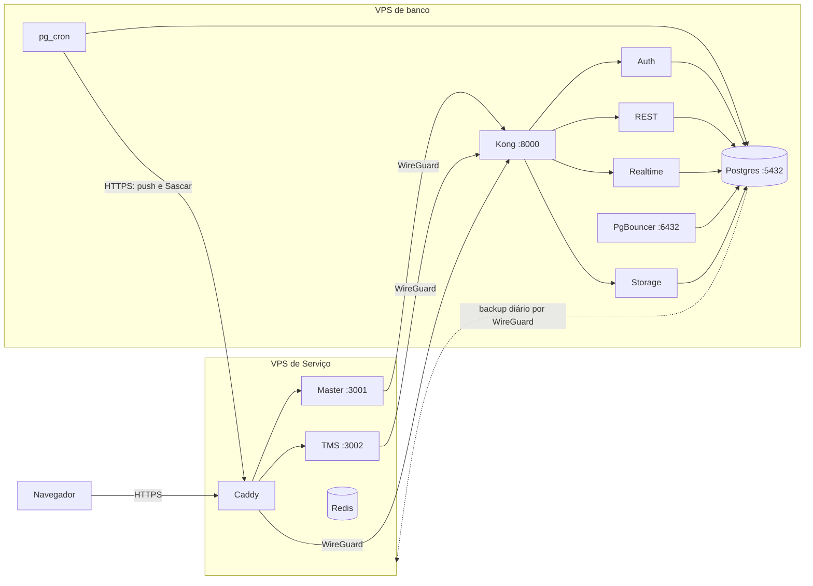

# Implantação nas VPS

Guia para quem opera o FrotaK. Instala o Master e o TMS em duas VPS Ubuntu, sobre um Supabase próprio. Este é o ambiente da Fase 1 do PDF "FrotaK Master · Arquitetura", adaptado ao banco único que o código usa hoje. Nenhum segredo nem IP real fica neste diretório.

## O que roda onde



| Porta aberta para a internet | VPS de banco | VPS de Serviço |
|---|---|---|
| 22 (SSH) | Sim | Sim |
| 80 e 443 (Caddy) | Não | Sim |
| 51820/udp (WireGuard) | Só para o IP da outra VPS | Só para o IP da outra VPS |

Postgres escuta em localhost. Kong e PgBouncer escutam só no IP da WireGuard. Redis e os apps escutam só em localhost. O Docker publica portas por fora do UFW, por isso `common/firewall.sh` acrescenta uma regra `DOCKER-USER` que descarta o que chega pela interface pública.

## O PDF e o que foi instalado

| Item do PDF | Situação | Observação |
|---|---|---|
| Painel e API Master | Instalado | Com 2FA obrigatório para a equipe, cobrado também no servidor e no banco |
| Catálogo de produtos e módulos | Instalado | No mesmo banco do TMS, não em Postgres próprio |
| TMS | Instalado | Um endereço para todos os clientes; o cliente vem do login, não do subdomínio |
| Front View | Não instalado | A VPS View só aceita chave SSH e a credencial recebida não entra |
| Redis | Instalado | O código ainda não usa; `REDIS_URL` já está no ambiente do TMS |
| Workers e filas | Parcial | Jobs do `pg_cron` chamam o TMS; não há worker separado |
| Object storage | Parcial | Supabase Storage em disco na VPS de banco, com pasta por bucket |
| PgBouncer | Instalado | Nenhum app conecta direto ao Postgres ainda; os apps usam a API |
| WireGuard | Instalado | Entre banco e Serviço |
| Backup com restauração testada | Instalado | Vai para a VPS de Serviço; trocar por object storage quando existir |
| Postgres 16 + Timescale | **Divergente** | Postgres 17, como no projeto atual. A imagem do Supabase 17 não traz Timescale, e nenhuma migration o usa |
| Um banco por cliente | **Não feito** | Banco único com RLS. O código depende de Auth, Realtime, Storage e RLS do Supabase; ver [arquitetura modular](../docs/frotak-master/arquitetura-modular.md#pendências) |
| Agente provisionador e mTLS | **Não feito** | Só fazem sentido com banco por cliente |
| Cofre de segredos | **Não feito** | Segredos em `/etc/frotak`, acessíveis só ao root, e cópia no backup sem criptografia |
| Fila de provisionamento | **Não feito** | O Master provisiona na hora, pela RPC `provision_tenant` |

## Instalar do zero

Em cada VPS, o conteúdo de `deploy/` fica em `/opt/frotak/deploy` e `supabase/migrations` em `/opt/frotak/supabase/migrations` (só na de banco). Preencha `/etc/frotak/hosts.env` a partir de `hosts.example.env`. Para gerar os pacotes no Windows, use `git -c core.autocrlf=false archive`, senão os scripts vão com CRLF.

| # | Onde | Comando |
|---|---|---|
| 1 | As duas | `ROLE=db common/base.sh` ou `ROLE=service common/base.sh` |
| 2 | As duas | `common/wireguard.sh keys`, depois `common/wireguard.sh up ADDR PEER_ADDR PEER_PUB PEER_IP` |
| 3 | As duas | `ROLE=... PEER_PUBLIC_IP=... WG_PEER=... common/firewall.sh` |
| 4 | As duas, em **sessão nova** | `systemctl stop frotak-ufw-rollback.timer`. Sem isso, o firewall desliga sozinho em 5 minutos |
| 5 | Banco | `db/install.sh` e `db/migrate.sh /opt/frotak/supabase/migrations` |
| 6 | Copiar | `/etc/frotak/shared.env` do banco para o Serviço, com permissão 600 |
| 7 | Serviço | `service/install.sh` |
| 8 | Serviço | `service/deploy-app.sh pacote.tar.gz NOME_DA_VERSAO` |
| 9 | Banco | `db/configure-cron.sh` |
| 10 | Banco | `OPERATOR_EMAIL=... db/bootstrap-operator.sh`. A senha fica em `/root/frotak-acesso-inicial.txt`; apague o arquivo depois do primeiro login |
| 11 | Banco, depois Serviço | `db/setup-backup.sh` imprime a chave; passe-a para `service/backup-target.sh "CHAVE"` |

## Acesso da equipe e 2FA

O Master exige um autenticador (Google Authenticator, Microsoft Authenticator ou outro TOTP). No primeiro login, a tela mostra o QR Code para cadastrar; depois pede o código a cada entrada. Quem é só cliente entra sem 2FA.

Operador perdeu o celular: rode `db/reset-mfa.sh operador@empresa.com.br` na VPS de banco. O 2FA dele é apagado, as sessões são encerradas e ele cadastra outro no próximo login.

O "Login como cliente" do Master abre o TMS como dono do cliente, com credencial de uso único e registro em `audit_logs` (`master.client_access`). O token do operador não sai do Master, e a aba mostra um aviso de modo suporte.

Com `VITE_FROTAK_HIDE_PROTOTYPES=true` (padrão nas VPS), o Master mostra só o que é real: os indicadores do Dashboard e a tela Clientes. As demais telas ainda usam dados fictícios e redirecionam para Clientes.

## Publicar uma nova versão

```bash
# No computador de desenvolvimento
git -c core.autocrlf=false archive --format=tar.gz HEAD -o app.tgz
scp app.tgz root@VPS_SERVICO:/tmp/app.tgz

# Migrations novas vão primeiro, na VPS de banco
/opt/frotak/deploy/db/migrate.sh /opt/frotak/supabase/migrations

# Na VPS de Serviço
/opt/frotak/deploy/service/deploy-app.sh /tmp/app.tgz NOME_DA_VERSAO
```

Para voltar atrás, as 3 últimas versões ficam em `/opt/frotak/releases`:

```bash
ln -sfn /opt/frotak/releases/ANTERIOR /opt/frotak/current
systemctl restart frotak-app@master frotak-app@tms
```

## Trocar para o domínio definitivo

1. Crie registros A para os três nomes apontando para a VPS de Serviço.
2. Edite `API_HOST`, `MASTER_HOST` e `TMS_HOST` em `/etc/frotak/hosts.env` nas duas VPS.
3. No banco: `db/install.sh` e `db/configure-cron.sh`.
4. No Serviço: `service/install.sh` e `service/deploy-app.sh`. É preciso novo build, porque as URLs públicas ficam gravadas no pacote do navegador.

## Chaves de terceiros

Edite `/etc/frotak/tms.secrets.env` na VPS de Serviço e rode `systemctl restart frotak-app@tms`. O script de instalação nunca sobrescreve este arquivo.

| Variável | Sem ela |
|---|---|
| `GEMINI_API_KEY` | A Frotak IA avisa que não está configurada |
| `GOOGLE_MAPS_API_KEY` | A busca de endereços usa só o OpenStreetMap |
| `SASCAR_USER`, `SASCAR_PASSWORD` ou `SASCAR_<SECRET_REF>_USER` e `_PASSWORD` | Rastreador não sincroniza |

Sem SMTP, o Auth não envia e-mail. O código atual não usa cadastro público nem recuperação de senha por e-mail, e os logins são criados pela API de administração. Para ligar o envio, acrescente `SMTP_HOST`, `SMTP_PORT`, `SMTP_USER`, `SMTP_PASS` e `SMTP_ADMIN_EMAIL` em `/etc/frotak/db.env` e rode `db/install.sh`.

## Backup e restauração

| O quê | Quando | Onde |
|---|---|---|
| Postgres (físico), Storage, chave do pgsodium e `/etc/frotak` | Todo dia às 06:30 UTC | `/var/backups/frotak`, 14 dias |
| Cópia do mesmo conteúdo | Logo depois | VPS de Serviço, `/var/backups/frotak-db`, 30 dias |
| Teste de restauração em contêiner descartável, sem rede | Domingo às 08:00 UTC | Resultado em `journalctl -u frotak-restore-test` |

Manualmente: `systemctl start frotak-backup` e `db/restore-test.sh`.

Restaurar numa VPS de banco nova (o teste semanal prova que a cópia sobe e bate com o banco; este roteiro completo ainda não foi ensaiado numa máquina nova):

1. Faça os passos 1 a 4 de [Instalar do zero](#instalar-do-zero) e extraia `etc-frotak.tar.gz` em `/etc`.
2. Crie o volume com `docker volume create frotak_db-config` e extraia `db-config.tar.gz` em `/var/lib/docker/volumes/frotak_db-config/_data`.
3. Extraia `postgres.tar.gz` em `/var/lib/frotak/db` e `storage.tar.gz` em `/var/lib/frotak`, como root, para manter os donos dos arquivos.
4. Dê `chmod 700 /var/lib/frotak/db` e rode `db/install.sh`, que mantém os segredos e sobe tudo.

O destino do backup na VPS de Serviço aceita a chave só pela WireGuard, só para gravar. Com essa chave, um invasor na VPS de banco não consegue baixar as cópias nem apagá-las com `--delete`.

## Pontos de atenção

- `common/base.sh` não desliga o login por senha, porque isso trancaria quem ainda não tem chave instalada. Depois de instalar uma chave, ajuste o `sshd` para `PasswordAuthentication no`.
- Ubuntu 26.10 não é LTS, com suporte de cerca de 9 meses. Para produção longa, prefira reinstalar em LTS.
- `vehicle_positions` guarda só as últimas 24 horas: o job `vehicle-positions-retention-hourly` apaga o resto, mesmo prazo da produção atual.
