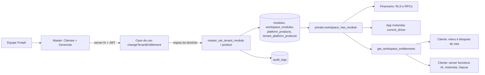
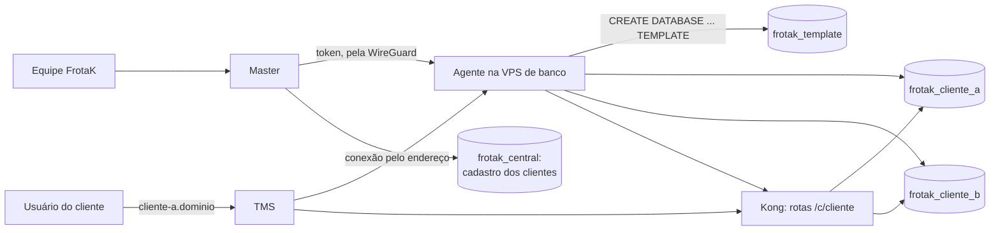

# FrotaK Master · arquitetura modular

Referência de produto: `FrotaK Master · Arquitetura.pdf` (2026-10-29). O Master liga e desliga produtos e módulos por cliente, e o app cliente obedece. O sistema roda em dois modos: **banco único**, na produção atual, e **um banco por cliente**, nas VPS (ver [Um banco por cliente](#um-banco-por-cliente)). O cofre de segredos fica para depois (ver [Pendências](#pendências)).

## Como a liberação chega ao cliente



Desligar não apaga dados, só bloqueia o acesso. Religar devolve o estado anterior. O banco recusa com `MODULE_DISABLED:<módulo>` (SQLSTATE 42501), e as server functions do cliente traduzem isso numa mensagem.

| Módulo (código) | Onde o bloqueio é garantido | O que some na interface |
|---|---|---|
| Gestão de Frota (`fleet_core`) | Módulo base: não desliga enquanto o TMS estiver liberado. Tabelas, RPCs e arquivos da frota exigem o módulo (`private.can_access_tenant` e `private.fleet_enabled_tenants`) | — |
| Financeiro (`financial`) | `can_read/manage/configure_financial_workspace`, `require_financial_permission`, `get_financial_access` | Menu Financeiro e rotas `/financeiro/*`, `/lucros-despesas` |
| Frotak IA (`frotak_ai`) | `resolveFrotakAiContext` (chat, voz, ferramentas, ações, push) e o disparo agendado de push | Menu e rota `/frotak-ia` |
| App Motorista (`driver_app`) | `private.current_driver()` (toda RPC do app) e `createDriverAppAccess` | — |
| Rastreadores (`frotak_tracking`) | `/api/sascar/sync`, que agora sempre exige `workspaceId` | — |
| Emissão de CT-e (`cte_issuance`) | Ainda não há tela nem API de CT-e no TMS | — |
| Produto TMS (`tms`) | Desligado, nenhum módulo do TMS vale | O app mostra "TMS FrotaK não liberado" |
| Cliente suspenso ou cancelado | `workspace_has_module` só libera tenants `active` e `trial` | O app mostra "Acesso da empresa suspenso" |

O menu do cliente lê as liberações ao carregar, a cada 60 s e quando a aba volta ao foco. As server functions consultam o banco em toda chamada. Sem TMS, com o cliente suspenso ou sem o módulo base, o menu fica só com Ajuda e a barra inferior do celular some. O Suporte (`/manual`) fica sempre acessível.

## Estrutura do código do Master

```
src/
  core/
    domain/        DomainError, PlatformActor e papéis da equipe
    auth/          platformAuth: middleware das server functions (JWT -> ator)
    server/        Supabase admin, resolvePlatformActor, runUseCase (só servidor)
  modules/
    catalog/       domínio: produtos e módulos (códigos são contrato com banco e cliente)
    entitlements/  liberar e bloquear produtos e módulos por cliente
    tenants/       lista de clientes, uso e resumo do dashboard
    provisioning/  cliente novo: em banco único, login do admin, provision_tenant e produtos; em banco por cliente, agente e cadastro no Central
  routes/          telas finas que chamam module/server.ts e module/ui
```

Cada módulo segue a mesma divisão:

| Camada | Pode importar | Papel |
|---|---|---|
| `domain/` | `core/domain`, domínio de outros módulos | Tipos e regras puras, sem I/O |
| `application/` | `domain/`, as próprias portas | Casos de uso e interfaces (portas) de persistência |
| `infrastructure/` | `application/` (portas), `core/server` | Adaptadores Supabase que implementam as portas |
| `server.ts` | tudo acima | Server functions: autenticação, validação e montagem do caso de uso |
| `ui/` | `domain/`, `server.ts` | Componentes React do módulo |

Regras que o build garante:

- Pasta chamada `server/` não pode ser importada pelo navegador (proteção de import do TanStack Start). Por isso o middleware fica em `core/auth`.
- Toda server function do Master usa `.middleware([platformAuth])`. Leitura vale para qualquer papel; escrita exige `super_admin` ou `operations` (`assertCanOperate` no caso de uso e `private.require_master_operator` no banco).
- A equipe FrotaK precisa de sessão com 2FA (`aal2`) em três pontos: login (`src/lib/auth.ts`), servidor (`resolvePlatformActor`) e banco (`private.is_platform_user`).
- Erros saem pelo `runUseCase`: um `DomainError` chega à tela com a mensagem; falha de infraestrutura vai para o log e o operador vê uma mensagem genérica.

## Estrutura do código do TMS (`central-dias-main`)

Cada módulo que o Master liga e desliga tem sua pasta, com o mesmo código usado no banco e no Master:

```
src/
  modules/
    registry.ts        lista dos módulos; monta menu e decide o dono de cada rota
    types.ts           formato do manifesto (TmsModule)
    fleet-core/        Gestão de Frota, o módulo base
    financial/         Financeiro
    frotak-ai/         Frotak IA
    frotak-tracking/   Rastreadores (Sascar)
    driver-app/        App Motorista
    cte-issuance/      Emissão de CT-e (só manifesto; ainda sem telas)
  lib/                 núcleo compartilhado: auth, supabase, tipos, formatação, liberações
  components/          casca do app (AppLayout, ThemeToggle) e componentes visuais compartilhados
  routes/              só definição de rota (URL, título, SSR); a tela vem do módulo
```

Dentro de cada módulo as dependências apontam para dentro, e o lint barra o que quebrar a regra (`central-dias-main/eslint.architecture.js`):

| Pasta | O que tem | Pode importar |
|---|---|---|
| `module.ts` | Manifesto: código, rótulo, rotas que são do módulo e itens de menu | — |
| `domain/` | Regras e tipos puros, sem acesso a banco, rede ou sessão | Só `domain/` |
| `application/` | Casos de uso e `ports.ts`, as interfaces do que o módulo precisa de fora | `domain/` e as próprias portas |
| `infrastructure/` | Adaptadores que implementam as portas: Supabase, RPCs, Sascar SOAP, Gemini, Web Push, voz | `application/` (portas) e `domain/` |
| `api/` | Server functions e handlers HTTP: autenticam, montam o caso de uso com os adaptadores e devolvem mensagens seguras | Todas as camadas do módulo |
| `container.ts` | Composição no navegador: liga casos de uso aos adaptadores | Todas as camadas do módulo |
| `ui/` | Telas (`ui/pages/`) e componentes | `domain/`, `container.ts` e `api/`, nunca `infrastructure/` |

O `AppLayout` não tem mais listas de menu fixas. Ele pede ao registro os itens dos módulos liberados (`operationalNav`) e usa `moduleForPath` para bloquear a rota de um módulo desligado. A pasta `api/` não se chama `server/` porque o TanStack Start bloqueia no navegador qualquer import de uma pasta com esse nome.

### Como integrar um fornecedor novo

Cada integração externa fica atrás de uma porta, e trocar ou somar um fornecedor não mexe em caso de uso nem em tela:

| Integração | Porta | Adaptador atual | Onde escolher |
|---|---|---|---|
| Rastreador | `TrackerProvider` | `SascarTrackerProvider` | `trackerProviders` |
| Modelo de IA | `AiModel`, `AiLiveSessionIssuer` | `GeminiAiModel`, `geminiLiveSessionIssuer` | `frotak-ai/api/frotakAi.ts` |
| Envio de push | `PushSender` | `sendWebPush` | `frotak-ai/api/frotakPush.ts` |
| Dados da frota | portas de `fleet-core/application/ports.ts` | `supabaseFleetAdapters` | `fleet-core/container.ts` |

Passos: escreva o adaptador em `infrastructure/` implementando a porta, troque a composição no `api/` ou no `container.ts` e cubra o caso de uso com portas falsas em `scripts/test-<modulo>-module.ts`. Esses testes rodam em Node puro com `npm run test:modules`, sem banco e sem rede; por isso `domain/` e `application/` não usam `enum` nem parameter properties.

`cte-issuance` ainda é só manifesto, porque não há funcionalidade de CT-e.

## Um banco por cliente

O modo vem da configuração: com `FROTAK_AGENT_URL` no servidor do Master e do TMS e `VITE_FROTAK_MULTI_DB=true` no build do TMS, cada cliente tem banco próprio. Sem elas, tudo funciona em banco único. A operação está em [deploy/README.md](../../deploy/README.md).



- **Criar:** o Master valida, pede o banco ao agente e só então cadastra no Central. Se o cadastro falhar, o banco é removido. Essa ordem evita cliente fantasma, porque os gatilhos do cadastro criam dados no banco onde rodam.
- **Liberar módulo:** `client-synced-entitlement-repository` aplica no banco do cliente primeiro e depois no Central. Quem obedece é o banco do cliente, com as mesmas regras do banco único.
- **TMS:** `src/server.ts` resolve a conexão pelo endereço da requisição e a guarda só durante a requisição. O navegador recebe as chaves do próprio cliente em `/frotak-client.js`.
- **Isolamento:** cada cliente tem JWT secret, chave anônima, chave de serviço e papéis de banco próprios, sem `CONNECT` para os outros. O Realtime é único, mas multi-tenant, com um slot por cliente.
- **Jobs:** ficam em `frotak_jobs`, com `cron.schedule_in_database` apontando para o banco de cada cliente. O `pg_cron` e o `pg_net` atendem um banco só e, em `postgres`, impediriam copiar o modelo.
- **Migration nova:** continua em `supabase/migrations`. O agente aplica no modelo, no Central e em todos os clientes. Guarde com `current_database()` o que depender de `pg_cron`, como em `202610150001`.

## Adicionar um módulo novo

1. **Banco**: uma migration nova insere o módulo em `public.modules` com `platform_product_id` e `sort_order`. Se o módulo já existe em uso, faça o backfill de `workspace_modules` para não cortar ninguém.
2. **Master**: acrescente o código em `ModuleCode` e em `modules` de `src/modules/catalog/domain/catalog.ts`. A tela de gerenciar e o formulário de cliente novo passam a mostrar o módulo sozinhos.
3. **TMS**: acrescente o código em `ModuleCode` (`central-dias-main/src/lib/entitlements.ts`), crie `src/modules/<modulo>/module.ts` com rotas e menu e inclua o manifesto em `src/modules/registry.ts`. O código do módulo vai nas pastas do próprio módulo; a rota em `src/routes` só importa a tela.
4. **Bloqueio de verdade**: chame `assertWorkspaceModule` na server function do módulo e/ou `private.workspace_has_module` na RPC ou policy. Esconder no menu não basta.
5. Atualize a tabela acima e `supabase/tests/master_product_module_entitlements.sql`.

## Implantação

Para as VPS, siga [deploy/README.md](../../deploy/README.md). O roteiro abaixo vale para a produção atual (Supabase e Lovable).

Ordem obrigatória: **migration primeiro, deploy depois**.

1. Conferir que nenhum cliente em uso está com status `provisioning`. A própria migration aborta com a lista de slugs se encontrar algum:
   ```sql
   select slug, status from public.tenants where status not in ('active', 'trial');
   ```
2. Aplicar as migrations pendentes, começando por `supabase/migrations/202610310001_master_product_module_entitlements.sql`. Ela:
   - cria `platform_products` (`tms`, `view`) e `tenant_platform_products`, e dá o TMS a todos os clientes existentes e aos novos (trigger);
   - adiciona o módulo `driver_app` e vincula os módulos do TMS ao produto;
   - **liga** `fleet_core`, `frotak_ai`, `frotak_tracking` e `driver_app` em todo workspace ativo que ainda não tinha registro, preservando o acesso de hoje;
   - passa a exigir o módulo no financeiro (inclusive para o dono) e no app motorista;
   - cria `get_workspace_entitlements`, `master_set_tenant_product`, `master_set_tenant_module` e `master_tenant_usage`.
3. Rodar `supabase/tests/master_product_module_entitlements.sql` num banco de teste.
4. Conferir que o TOTP está ligado em Auth > MFA no Supabase e publicar o Master e o Cliente **logo depois** de aplicar `202611050001`: ela passa a exigir 2FA da equipe no banco, e um Master antigo não pede o código.
5. No Master, desligar os módulos que cada cliente **não** contratou. O backfill liga tudo para não causar corte surpresa.

Antes da migration, o código novo continua funcionando: o Master mostra todos os clientes com TMS e recusa alterações com a instrução de aplicar a migration; o Cliente trata a função ausente como "tudo liberado", como hoje.

## Pendências

| Item | Situação |
|---|---|
| Cofre de segredos, mTLS com o agente, fila de jobs repetíveis e armazenamento de objetos (PDF) | Não feitos. Hoje: arquivos em `/etc/frotak`, WireGuard com token, `pg_cron` e uma thread do agente, disco da VPS. Ver [deploy/README.md](../../deploy/README.md). |
| Roteamento por subdomínio | Feito no modo banco por cliente. Em banco único, o cliente é descoberto pela membership do usuário. Em domínio definitivo, exige DNS curinga. |
| Produto View | Gravado no catálogo; nenhum sistema consome ainda. O backend do View deve ler `get_workspace_entitlements` ou o catálogo. |
| CT-e | Módulo existe no catálogo; não há funcionalidade de CT-e para bloquear. |
| Suspender e encerrar cliente pelo Master | Sem tela (Fase 2 do PDF). O bloqueio por status já funciona, e o agente tem `POST /clients/<slug>/status` e `DELETE /clients/<slug>`, ainda só pela API. |
| Troca de senha nos apps | Sem tela no Master e no TMS. O login é marcado com `must_change_password`, mas nada pede a troca. |
| Telas do Master com dados fictícios (`/usuarios`, `/financeiro`, `/operacoes` e outras) | Continuam no protótipo. Ficam escondidas com `VITE_FROTAK_HIDE_PROTOTYPES=true`, padrão nas VPS. |
