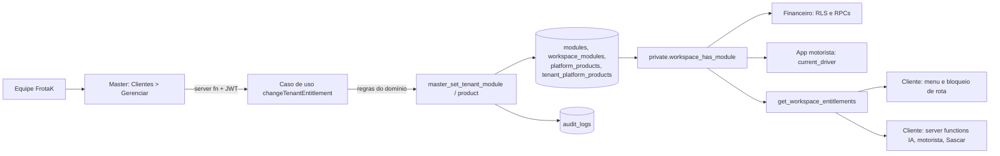

# FrotaK Master · arquitetura modular

Referência de produto: `FrotaK Master · Arquitetura.pdf` (2026-10-29). Esta é a **Fase 1 adaptada ao banco único atual**: o Master liga e desliga produtos e módulos por cliente, e o app cliente obedece. O banco por cliente, o agente provisionador na VPS e o cofre de segredos ficam para depois (ver [Pendências](#pendências)).

## Como a liberação chega ao cliente



Desligar não apaga dados, só bloqueia o acesso. Religar devolve o estado anterior. O banco recusa com `MODULE_DISABLED:<módulo>` (SQLSTATE 42501), e as server functions do cliente traduzem isso numa mensagem.

| Módulo (código) | Onde o bloqueio é garantido | O que some na interface |
|---|---|---|
| Gestão de Frota (`fleet_core`) | Módulo base: não desliga enquanto o TMS estiver liberado | — |
| Financeiro (`financial`) | `can_read/manage/configure_financial_workspace`, `require_financial_permission`, `get_financial_access` | Menu Financeiro e rotas `/financeiro/*`, `/lucros-despesas` |
| Frotak IA (`frotak_ai`) | `resolveFrotakAiContext` (chat, voz, ferramentas, ações, push) e o disparo agendado de push | Menu e rota `/frotak-ia` |
| App Motorista (`driver_app`) | `private.current_driver()` (toda RPC do app) e `createDriverAppAccess` | — |
| Rastreadores (`frotak_tracking`) | `/api/sascar/sync` com `workspaceId` (manual e agendado) | — |
| Emissão de CT-e (`cte_issuance`) | Ainda não há tela nem API de CT-e no TMS | — |
| Produto TMS (`tms`) | Desligado, nenhum módulo do TMS vale | O app mostra "TMS FrotaK não liberado" |
| Cliente suspenso ou cancelado | `workspace_has_module` só libera tenants `active` e `trial` | O app mostra "Acesso da empresa suspenso" |

O menu do cliente lê as liberações ao carregar, a cada 60 s e quando a aba volta ao foco. As server functions consultam o banco em toda chamada. Sem TMS, com o cliente suspenso ou sem o módulo base, o menu fica só com Ajuda e a barra inferior do celular some. O Suporte (`/manual`) fica sempre acessível.

## Estrutura do código do Master

```
src/
  core/
    domain/        DomainError, PlatformActor e papéis da equipe
    auth/          platformAuth: middleware das server functions (JWT -> ator)
    server/        Supabase admin, resolvePlatformActor, runUseCase (só servidor)
  modules/
    catalog/       domínio: produtos e módulos (códigos são contrato com banco e cliente)
    entitlements/  liberar e bloquear produtos e módulos por cliente
    tenants/       lista de clientes, uso e resumo do dashboard
    provisioning/  cliente novo: login do admin, provision_tenant, produtos
  routes/          telas finas que chamam module/server.ts e module/ui
```

Cada módulo segue a mesma divisão:

| Camada | Pode importar | Papel |
|---|---|---|
| `domain/` | `core/domain`, domínio de outros módulos | Tipos e regras puras, sem I/O |
| `application/` | `domain/`, as próprias portas | Casos de uso e interfaces (portas) de persistência |
| `infrastructure/` | `application/` (portas), `core/server` | Adaptadores Supabase que implementam as portas |
| `server.ts` | tudo acima | Server functions: autenticação, validação e montagem do caso de uso |
| `ui/` | `domain/`, `server.ts` | Componentes React do módulo |

Regras que o build garante:

- Pasta chamada `server/` não pode ser importada pelo navegador (proteção de import do TanStack Start). Por isso o middleware fica em `core/auth`.
- Toda server function do Master usa `.middleware([platformAuth])`. Leitura vale para qualquer papel; escrita exige `super_admin` ou `operations` (`assertCanOperate` no caso de uso e `private.require_master_operator` no banco).
- Erros saem pelo `runUseCase`: um `DomainError` chega à tela com a mensagem; falha de infraestrutura vai para o log e o operador vê uma mensagem genérica.

## Adicionar um módulo novo

1. **Banco**: uma migration nova insere o módulo em `public.modules` com `platform_product_id` e `sort_order`. Se o módulo já existe em uso, faça o backfill de `workspace_modules` para não cortar ninguém.
2. **Master**: acrescente o código em `ModuleCode` e em `modules` de `src/modules/catalog/domain/catalog.ts`. A tela de gerenciar e o formulário de cliente novo passam a mostrar o módulo sozinhos.
3. **Cliente**: acrescente o código em `central-dias-main/src/lib/entitlements.ts` (`ModuleCode`, `MODULE_LABELS` e, se o módulo tiver rotas, `ROUTE_MODULES`).
4. **Bloqueio de verdade**: chame `assertWorkspaceModule` na server function do módulo e/ou `private.workspace_has_module` na RPC ou policy. Esconder no menu não basta.
5. Atualize a tabela acima e `supabase/tests/master_product_module_entitlements.sql`.

## Implantação

Ordem obrigatória: **migration primeiro, deploy depois**.

1. Conferir que nenhum cliente em uso está com status `provisioning`. A própria migration aborta com a lista de slugs se encontrar algum:
   ```sql
   select slug, status from public.tenants where status not in ('active', 'trial');
   ```
2. Aplicar `supabase/migrations/202610310001_master_product_module_entitlements.sql`. Ela:
   - cria `platform_products` (`tms`, `view`) e `tenant_platform_products`, e dá o TMS a todos os clientes existentes e aos novos (trigger);
   - adiciona o módulo `driver_app` e vincula os módulos do TMS ao produto;
   - **liga** `fleet_core`, `frotak_ai`, `frotak_tracking` e `driver_app` em todo workspace ativo que ainda não tinha registro, preservando o acesso de hoje;
   - passa a exigir o módulo no financeiro (inclusive para o dono) e no app motorista;
   - cria `get_workspace_entitlements`, `master_set_tenant_product`, `master_set_tenant_module` e `master_tenant_usage`.
3. Rodar `supabase/tests/master_product_module_entitlements.sql` num banco de teste. Para montar um banco do zero, veja o achado sobre `touch_updated_at` no [checkpoint](CHECKPOINT.md).
4. Publicar o Master e o Cliente.
5. No Master, desligar os módulos que cada cliente **não** contratou. O backfill liga tudo para não causar corte surpresa.

Antes da migration, o código novo continua funcionando: o Master mostra todos os clientes com TMS e recusa alterações com a instrução de aplicar a migration; o Cliente trata a função ausente como "tudo liberado", como hoje.

## Pendências

| Item | Situação |
|---|---|
| Banco por cliente, agente provisionador na VPS, PgBouncer, cofre e jobs repetíveis (PDF, Fases 1 a 3) | Não iniciado. Exige reescrever o acesso a dados do TMS, que hoje fala direto com o Supabase. A porta `TenantProvisioner` é o ponto de troca no Master. |
| Roteamento por subdomínio | Não feito; o cliente é descoberto pela membership do usuário. |
| Tabelas de frota (veículos, fretes etc.) | RLS por tenant, sem checagem de módulo. Só importa se o TMS for desligado: o app bloqueia as telas, mas a API do Supabase ainda responde a esse usuário. |
| Produto View | Gravado no catálogo; nenhum sistema consome ainda. O backend do View deve ler `get_workspace_entitlements` ou o catálogo. |
| CT-e | Módulo existe no catálogo; não há funcionalidade de CT-e para bloquear. |
| Suspender e encerrar cliente pelo Master | Não feito (Fase 2 do PDF). O bloqueio por status já funciona. |
| Sincronização Sascar global (sem `workspaceId`) | Modo legado sem checagem de módulo. |
| "Login como cliente" | Ainda envia o token do próprio usuário Master ao app cliente. Precisa de um fluxo de personificação próprio. |
| Usuários do Master (tela `/usuarios`) e demais telas com dados fictícios | Fora deste escopo; continuam no protótipo. |
